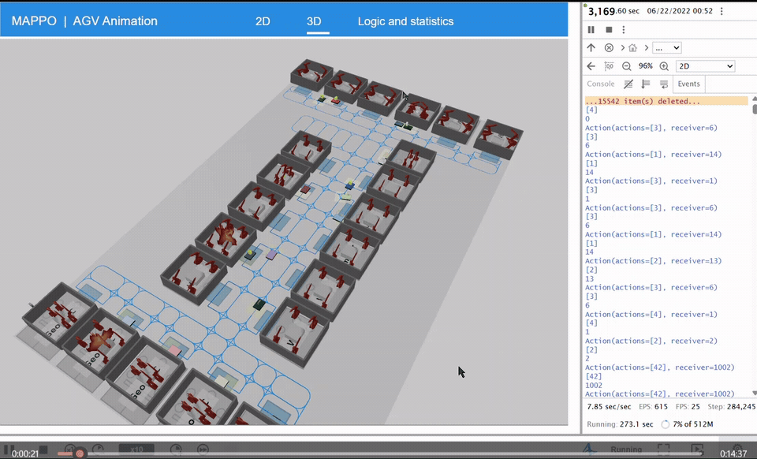
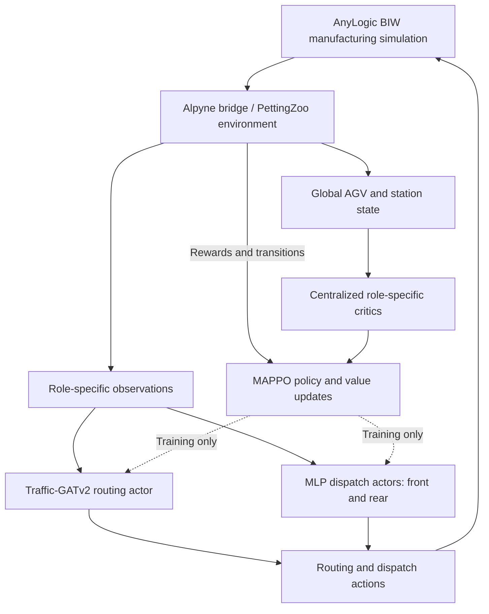
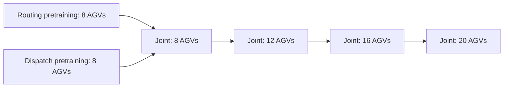

# Multi-Agent Reinforcement Learning for AGV Coordination in BIW Manufacturing

**MAPPO · Traffic-Aware GATv2 · AnyLogic · PyTorch**

An individual research project investigating multi-agent reinforcement learning (MARL) for coordinating automated guided vehicles (AGVs) in a simulated automotive Body-in-White (BIW) manufacturing system.

The objective is to improve production throughput and reduce traffic blocking by jointly learning **AGV routing** and **production-aware dispatching** policies.

**Research foundation:** This project builds on the publicly available AnyLogic Matrix simulation and Python reinforcement learning code released by [Tobias Wegmann (tobihoernchen)](https://github.com/tobihoernchen/thesis). My contributions focus on implementing MAPPO and extending the existing GNN-based routing architecture with traffic-aware GATv2 features. See [Author and Acknowledgments](#9-author-and-acknowledgments) for attribution and references.

## Simulation Demo



*Visualization of AGV coordination in the AnyLogic manufacturing environment.*

## 1. Project Overview

In a matrix manufacturing system, multiple AGVs share a transportation network and move components between processing stations. As fleet size increases, interactions between vehicles can create congestion, blocking and inefficient transportation decisions.

This project formulates AGV coordination as a multi-agent decision-making problem with two complementary tasks:

- **Routing:** selecting the next movement action on the transportation network.
- **Dispatching:** selecting the next target station for an AGV according to its assigned component and the manufacturing process.

The project focuses on AGV coordination rather than full factory-wide production scheduling. All reported experiments are simulation-based; physical AGV deployment is outside the current scope.

## 2. Methodology

### Multi-Agent Proximal Policy Optimization (MAPPO)

The learning system follows the Centralized Training and Decentralized Execution (CTDE) paradigm. Centralized, role-specific critics use global AGV and station information during training, while actors make decisions using their corresponding observations during execution.

| Policy role | Neural network | Decision |
| --- | --- | --- |
| Routing | Traffic-aware Graph Attention Network (Traffic-GATv2) | Next movement action |
| Front dispatching | MLP-based actor | Target station selection |
| Rear dispatching | MLP-based actor | Target station selection |



### Traffic-Aware Graph Attention Network

The transportation network is represented as a graph, where nodes represent network locations and edges represent connections. The current Traffic-GATv2 implementation uses seven edge features:

| Edge feature | Description |
| --- | --- |
| Geometric length | Normalized connection length |
| Same-direction flow | Other AGVs traveling in the same direction |
| Opposite-direction flow | Other AGVs traveling in the opposite direction |
| Downstream pressure | Other AGVs targeting the downstream next node |
| Stationary-vehicle proxy | Other AGVs whose previous and next nodes coincide |
| Destination demand | Other AGVs with demand toward the destination |
| Bottleneck score | Topological bottleneck indicator |

Edge information is incorporated into both attention scores and message content, allowing the routing actor to learn traffic-aware representations. The learned routing actor produces five action logits without an explicit routing action mask in the current implementation.

### Production-Aware Dispatching

The MLP-based dispatch actors select target stations from their observations using dispatch action masks. The repository also contains an experimental operation-first masking implementation that considers rework, the next required GEO station, eligible processing operations and buffer fallback. This is not a complete capacity-aware production scheduler.

## 3. Training Strategy

The staged training pipeline supports separate role pretraining followed by joint policy training with progressively larger AGV fleets.



During role-specific pretraining, non-learning controllers provide decisions for the other roles. The joint stages train routing and both dispatch policies. The training pipeline includes checkpoint initialization, resume support, experiment metadata and checkpoint integrity checks. The current PowerShell runner targets a traffic-aware Joint16 experiment initialized from a compatible earlier checkpoint.

## 4. Experimental Results

The following results were recorded in project experiments against a baseline using DQN-based routing and PPO-based dispatching. The throughput metric is the mean number of completed jobs (`JobDone`) over the evaluation horizon.

| Fleet size | Baseline mean JobDone | MAPPO-based mean JobDone | Relative improvement |
| --- | ---: | ---: | ---: |
| 16 AGVs | 11.0 | 13.0 | **+18.2%** |
| 20 AGVs | 4.9 | 8.2 | **+67.3%** |

For the reported 20-AGV experiment, 10 held-out simulation seeds (900001–900010) yielded an average of 8.2 completed jobs and 10.2 blocking events per run. The observed reduction in blocking events relative to the baseline was approximately 50%.

The evaluation pipeline supports deterministic greedy policy evaluation for 3,600 simulated seconds per seed without PPO updates. It records checkpoint identifiers, seeds and environment statistics, including completed jobs, blocking, livelock, target reached and wrong target events.

**Interpretation:** These are descriptive results from the reported project runs, not a claim of statistical significance, guaranteed collision-free operation or generalization to physical factories. The raw baseline logs and matching experiment checkpoints are not included in the current public repository; the figures should not be interpreted as independently reproducible from this source checkout alone. The results are not attributed specifically to the latest traffic-edge architecture revision without a matching checkpoint record.

## 5. Repository Structure

```text
MAPPO-GNN-AnyLogic/
├── envs/                         # AnyLogic simulation models and assets
│   ├── Matrix/                   # Matrix manufacturing environment
│   ├── Matrix1/                  # Matrix variants and animation model
│   ├── MiniMatrix/               # Smaller matrix environment
│   └── ...
├── scripts/
│   ├── train.py                  # Staged MAPPO training and resume
│   ├── evaluate.py               # Held-out checkpoint evaluation
│   ├── stage_policy.py           # Role-specific staged training behavior
│   ├── summarize_heldout.py      # Evaluation log statistics
│   ├── run.ps1                   # Current Joint16 experiment runner
│   └── plot_mappo_training_timesteps.py
├── thesis/
│   ├── envs/                     # Alpyne bridge, observations and dispatch logic
│   ├── mappo/                    # MAPPO algorithm, collector and neural networks
│   │   ├── algorithm.py
│   │   ├── collector.py
│   │   ├── model_architecture.py # Routing actors, dispatch actors and critics
│   │   └── fullrollout_optimizer.py
│   ├── policies/                 # Supporting policy implementations
│   ├── pypeline_connectors/      # AnyLogic/Python integration and inference
│   └── utils/                    # Configuration utilities
├── tests/                        # Training, routing and dispatch tests
└── requirements.txt              # Python dependency snapshot
```

## 6. Technologies

| Category | Tools |
| --- | --- |
| Programming | Python, Java (AnyLogic model logic) |
| Deep learning | PyTorch, NumPy |
| Reinforcement learning interfaces | PettingZoo, Gymnasium |
| Simulation and integration | AnyLogic, Alpyne, Pypeline |
| Graph representation | NetworkX, graph attention networks |
| Analysis and visualization | Matplotlib |

## 7. Getting Started

The repository contains the research source code and AnyLogic model files (`.alp`). It does not currently provide a self-contained training package.

### Python environment

The recorded dependency snapshot targets Python 3.11 on Windows x64 with a CUDA-enabled PyTorch build. Use an appropriate GPU/driver configuration, and verify availability of the pinned dependencies before installing.

```powershell
git clone https://github.com/trilehoangminh-source/MAPPO-GNN-AnyLogic.git
cd MAPPO-GNN-AnyLogic
py -3.11 -m venv .venv311
.\.venv311\Scripts\python.exe -m pip install -r requirements.txt
```

### Training and evaluation

Before running a full experiment, prepare the compatible AnyLogic RL simulator export (`.zip`), configuration/topology blueprint and any required initialization checkpoints. These generated artifacts are excluded from Git by the current `.gitignore`. The evaluation and animation scripts also require the matching trained checkpoints and run metadata.

Inspect the available command-line options:

```powershell
.\.venv311\Scripts\python.exe scripts\train.py --help
.\.venv311\Scripts\python.exe scripts\evaluate.py --help
```

For the current Joint16 PowerShell workflow, after restoring its required reference run artifacts and paths:

```powershell
.\scripts\run.ps1 -Action dryrun
.\scripts\run.ps1 -Action init
.\scripts\run.ps1 -Action train -MaxEpisodes 1000
.\scripts\run.ps1 -Action eval -Seeds 10
```

Run `init` only for a new experiment. For an existing initialized run, use `train` to resume. The runner validates the source checkpoint and does not overwrite an existing initialized experiment. Commands are documented from the source; they have not been executed in this README review.

## 8. Project Status and Future Work

- Evaluate policies across additional traffic conditions, layouts and fleet sizes.
- Investigate blocking and livelock reduction in dense manufacturing scenarios.
- Perform controlled ablation studies of traffic-aware graph features.
- Improve reproducibility by publishing matched configurations, checkpoints and evaluation logs where possible.
- Investigate future sim-to-real transfer to physical AGV systems.

## 9. Author and Acknowledgments

**Le Hoang Minh Tri** — Control Engineering and Automation, Ho Chi Minh City University of Technology (HCMUT), VNU-HCM.

Individual research project, September 2026 – present.

GitHub: [trilehoangminh-source](https://github.com/trilehoangminh-source)

### Acknowledgments and research foundation

I would like to express my sincere thanks to **Tobias Wegmann** ([`tobihoernchen`](https://github.com/tobihoernchen)) for publicly sharing his research code and AnyLogic simulation models. His work on reinforcement learning for matrix-structured production systems provided an essential foundation for this project and made it possible for me to explore and develop new approaches to multi-agent AGV coordination.

**Original repository:** [tobihoernchen/thesis](https://github.com/tobihoernchen/thesis)

The AnyLogic Matrix manufacturing environment, existing Python environment interfaces, routing and dispatching logic, and original neural-network implementations are inherited or adapted from the upstream research. Credit for these foundations belongs to the original authors.

### Contributions of this project

Building on that foundation, I have focused on:

- Implementing a MAPPO-based learning system using centralized training and decentralized execution (CTDE) for AGV routing and dispatching.
- Extending the inherited GNN-based routing architecture with Traffic-GATv2, incorporating seven edge features into attention and message passing.
- Developing the staged training, checkpoint management and evaluation pipeline for experiments with 8, 12, 16 and 20 AGVs.
- Investigating production throughput and traffic blocking relative to the original DQN-routing and PPO-dispatching approach.

This is an independent extension of the original research, not a claim of authorship of the underlying simulation model or inherited code.

### References

- Wegmann, T. (2023). [Production Control with Reinforcement Learning for a Matrix-Structured Production System — research code](https://github.com/tobihoernchen/thesis).
- Steinbacher, L. M., Wegmann, T., & Freitag, M. (2025). [Production control with Reinforcement Learning for a matrix-structured production system](https://doi.org/10.1080/00207543.2024.2436126). *International Journal of Production Research, 63*(11), 4114–4136. (Published online December 10, 2024.)

**Upstream licensing:** The upstream repository is publicly accessible, but no explicit software license was found in its root or GitHub license metadata at the time of review. Public availability does not itself grant permission to redistribute modified source code or assets. The original copyright and any applicable third-party rights remain with their respective holders; redistribution permissions should be confirmed with the author.
